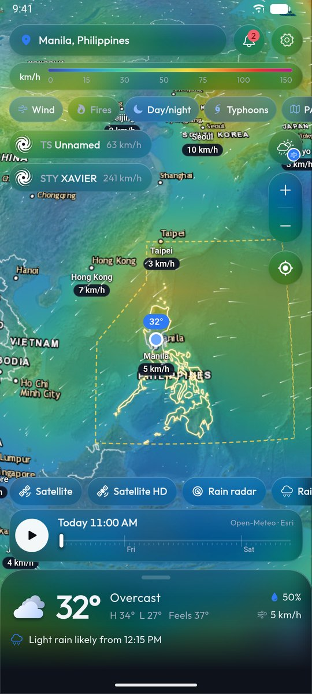
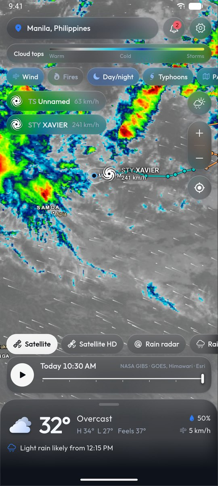
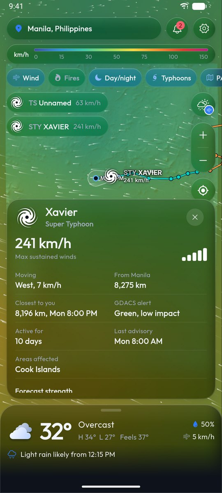
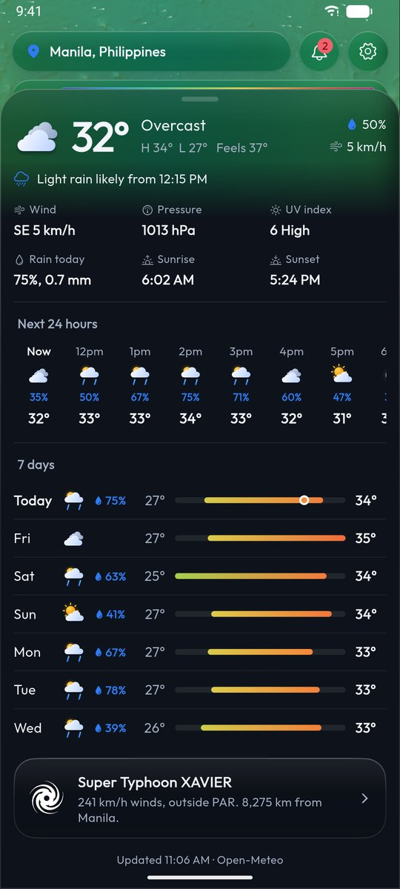

  

  <b><a href="https://github.com/Levi-crown/LibreForcast/releases/latest">Download the latest APK</a></b> 
  Android 7.0 or newer. Free, no ads, no sign-in.

 

<table>
  <tr>
    <td align="center"></td>
    <td align="center"></td>
    <td align="center"></td>
    <td align="center"></td>
  </tr>
  <tr>
    <td align="center">Wind and the PAR boundary</td>
    <td align="center">Live satellite</td>
    <td align="center">Typhoon tracker</td>
    <td align="center">Your forecast</td>
  </tr>
</table>

## About

LibreForecast is a free weather app for Android. It opens straight to a 3D globe with live satellite pictures, rain radar, and forecast maps for the next 48 hours. Pull up from the map to see today's weather, the next 24 hours and the next 7 days.

It was made in the Philippines, so it has a typhoon tracker with PAGASA categories and the PAR boundary. But it isn't only for the Philippines. The maps and the forecast work anywhere in the world.

There is no account to make. No sign-in, no email, no password. Your settings and the places you look up stay on your phone, and there is no LibreForecast server that keeps a copy. No ads and no analytics.

## What it can do

**On the map**

- **3D globe.** The map is a globe you can spin and zoom. It opens the moment you start the app.
- **Live satellite.** Cloud pictures from the Himawari and GOES satellites for the last 3 hours, plus a sharp daily true-colour view of the whole Earth.
- **Rain radar.** Where it's raining right now, with the last 2 hours to play back.
- **Forecast maps.** Rain, wind, temperature, humidity and air pressure for the next 48 hours. Every layer has a colour legend.
- **Overlays.** Moving wind over any layer, fires and heat spots, day and night, place names and borders, and a grid with coordinates.
- **Timeline.** Play or drag through the forecast hours, radar frames or satellite frames, and jump back to now.
- **Tap anywhere.** See the weather at any spot on the map, and use it as your location if you want.
- **Measure.** Measure distance and area right on the map.

**Storms and alerts**

- **Typhoon tracker.** Where a storm has been and where it's going, its cone of uncertainty, the PAR boundary, PAGASA categories, and how far it is from you.
- **Rain soon?** "Rain likely from 9:45 PM" for where you are, in 15-minute steps.
- **Alerts.** Weather and typhoon notifications, made on your phone. Turn them off any time in Settings.

**Your way**

- **Units.** °C or °F. Wind in km/h, m/s, mph, knots or Beaufort. Pressure in hPa, mmHg or inHg. Distance in km, miles or nautical miles. 12 or 24 hours, local time or UTC.

## Download

Get the newest version from **[Releases](https://github.com/Levi-crown/LibreForcast/releases/latest)**.

> [!IMPORTANT]
> **Make sure you download the latest version.** Pick the release marked **Latest**, not an older one. Older versions miss fixes and new features, and the free weather services the app uses can change, so an old version may stop showing some maps.

| File | Pick this if |
| :--- | :--- |
| `LibreForecast-x.x.x-arm64-v8a.apk` | You have a phone from the last few years. Most people need this one. |
| `LibreForecast-x.x.x-armeabi-v7a.apk` | You have an older phone. |
| `LibreForecast-x.x.x-universal.apk` | You're not sure which one. It works on every phone but is a bigger download. |

> [!WARNING]
> **Not an official warning service.** Always follow PAGASA and your local authorities during storms and emergencies.

## Credits

| Data | Source |
| :--- | :--- |
| Forecast and place search | [Open-Meteo.com](https://open-meteo.com) (CC BY 4.0) |
| Satellite and fires | [NASA GIBS](https://www.earthdata.nasa.gov/engage/open-data-services-software/earthdata-developer-portal/gibs-api), from Himawari, GOES and NOAA-20 VIIRS |
| Rain radar | [RainViewer](https://www.rainviewer.com) |
| Typhoons | [GDACS](https://www.gdacs.org) (UN and European Commission), with JTWC advisories |
| Base map | © [Esri](https://www.esri.com) World Gray Canvas |
| Town names | [BigDataCloud](https://www.bigdatacloud.com) |
| Map engine | [MapLibre GL JS](https://maplibre.org) (BSD-3-Clause) |

Built with Flutter, Dart and Kotlin.

## Legal

LibreForecast is free to use, but it is not open source. See the [License](LICENSE), [Privacy Policy](PRIVACY.md) and [Terms of Use](TERMS.md).

## Contact

Found a bug, have an idea to make the app better, or want something added in a future update? Message me on **[Telegram](https://t.me/hachi0427)** or **[Facebook](https://web.facebook.com/chris.benedict.00)**.

## Support

LibreForecast is free and has no ads. If it helps you, you can support it with a coffee.

 
 

  Made in the Philippines by <a href="https://github.com/Levi-crown">Levi Crown</a>

